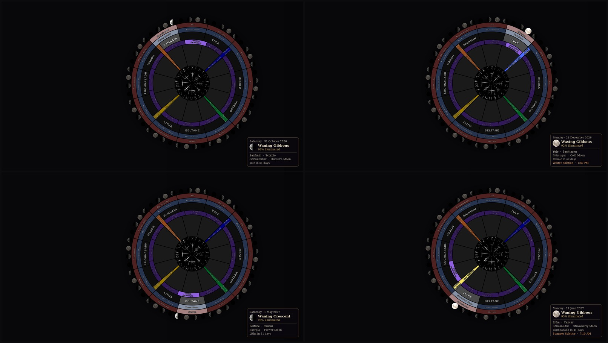
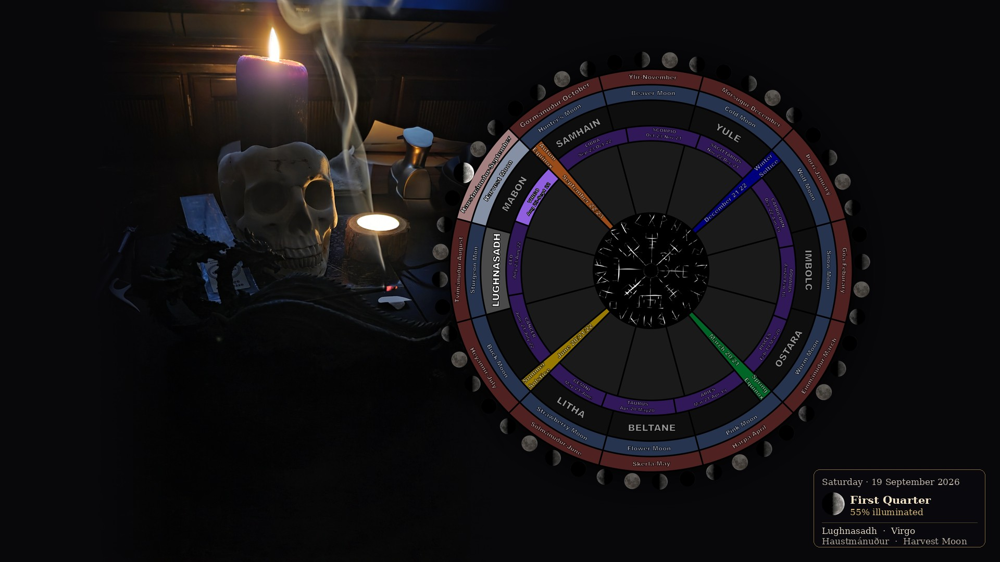

# Wheel of the Year Wallpaper

A desktop wallpaper that keeps track of where the year actually is.

Every day it redraws itself and lights up what's current: the **Sabbat**, the **zodiac sign**,
the **month** (Old Norse and the almanac moon name), **tonight's moon phase**, and — on the day
itself — the **solstice or equinox**. A small panel in the corner gives the date, the phase and
how much of the moon is lit.

Free, no account, no internet needed after you download it. Windows 10/11 and Linux.

With your own photographs behind it:

---

## Get it

Download the newest zip from the [Releases page](../../releases):

| You use | Download | Then |
|---|---|---|
| **Windows 10/11** | `Wheel of the Year - Windows 10-11 vX.Y.Z.zip` | Unzip, double-click `Install.cmd` |
| **Linux** (KDE Plasma or GNOME) | `Wheel of the Year - Linux vX.Y.Z.zip` | Unzip, run `./install.sh` |
| **macOS** | not yet — [see below](#macos) | |

The Windows download brings its own copy of Python, so there is nothing else to install.
On Linux you need Python 3.11+ and Pillow (`sudo apt install python3-pil` on Kubuntu/Ubuntu).

After installing you get a **"Wheel of the Year" folder on your desktop** with three shortcuts:
**Pictures** (the folders it reads), **Settings**, and **Update Wallpaper Now**.

It refreshes every night just after midnight, and catches up when you next switch the computer
on if it was off.

## Make it yours

The wheel is Norse, but the year isn't. Everything you'd want to change is a folder or a line
in a text file — no code, no rebuilding:

| Folder | What goes in it |
|---|---|
| `backgrounds/<Sabbat>/` | The photo behind the wheel, one folder per Sabbat. Every picture is used, a different one each day. Empty = black. |
| `backgrounds/Any/` | Photos used whenever a Sabbat's own folder is empty |
| `wedges/01-January` … `12-December` | A picture for each of the 12 large inner wedges |
| `sabbat-ring/<A-B>/` | Symbols for the four unnamed slots in the Sabbat ring — runes, a pentacle, whatever suits your path |
| `center/` | Replaces the Vegvísir in the middle |

And in `config.toml`:

- **Your own names** for the Sabbats — Lammas instead of Lughnasadh, Midwinter instead of Yule.
- **Your own dates** — ancestors, anniversaries, birthdays. They appear in the panel on the day.
- **Month names** in Old Norse, modern, or both — on the wheel as well as the panel.
- **Moonrise and moonset**, sunrise and sunset, a countdown to the next Sabbat.
- **Southern hemisphere**, worked out from your time zone or set by hand: the Sabbats move to
  where they belong and the names swap to the opposite side of the wheel.
- **Colours, sizes and dimming** for every ring.

A mistake in the settings never stops the wallpaper: it falls back to the default and writes a
plain-English note in `build/log.txt`.

## Accuracy

Solstices and equinoxes are calculated for your time zone and are right to the minute; the moon
phase and its rise and set times come from the same source (Meeus, *Astronomical Algorithms*).
Nothing is looked up online, and nothing about you leaves your computer. Rise and set times
need a rough position, which is estimated from your time zone unless you'd rather type it in.

## macOS

Not built yet. Most of it would work as it is; the Mac-specific parts (setting the wallpaper,
screen size, the daily schedule) still need writing and, more importantly, testing. **If you
use a Mac and would be willing to test, please open an issue** — that's all that's holding it
up.

## Something not right?

Open an issue with `build/log.txt` from your folder and what you expected to happen. The log
records every run and the version you're on.

## Credits and licence

MIT for the program and the wheel artwork; the moon icons are CC BY-SA 4.0 and the font is
DejaVu. Full details in [CREDITS.md](CREDITS.md) and [LICENSE](LICENSE).

Changes between versions are in [CHANGELOG.md](CHANGELOG.md). If you'd like to work on it, the
workshop notes are in [docs/WORKSHOP.md](docs/WORKSHOP.md).
